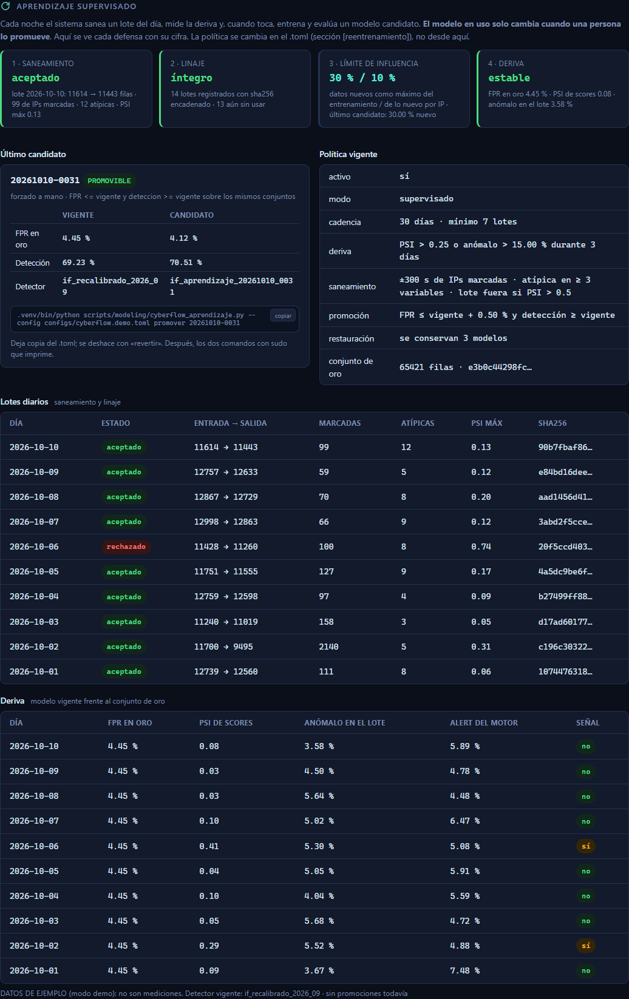

# Aprendizaje supervisado: cómo se reentrena CyberFlow sin dejarse envenenar

CyberFlow aprende de la red que vigila, pero **no se despliega solo**. Cada noche
el sistema prepara y evalúa un modelo candidato. El modelo en uso cambia únicamente
cuando una persona ejecuta `promover`, y esa acción se deshace con `revertir`.

**Por qué no es automático del todo.** Un detector que se reentrena y se despliega
solo puede aprender un ataque lento como si fuera normal. Basta con que el atacante
meta su tráfico poco a poco en la línea base: es el **envenenamiento de datos**.
Las cuatro defensas de abajo lo dificultan. La aprobación humana lo cierra.

```
 acumulador (cada 10 min) ──► multilayer-v3.csv
                                   │
 00:30 UTC · cyberflow-aprendizaje.timer
   ① lote del día ── saneamiento ──► lotes/lote-AAAAMMDD.csv
   ② linaje ───────────────────────► registro.jsonl (sha256 encadenado)
   ④ deriva contra el conjunto de oro ► deriva.jsonl
   ③ si toca: candidato con límite de influencia ► candidatos/<id>/
                                   │  veredicto PROMOVIBLE / NO_PROMOVER / EVALUACION_INCOMPLETA
                                   ▼
 una persona:  promover <id>   ·   revertir
```

Todo vive en `artifacts/aprendizaje/` y lo hace
[`scripts/modeling/cyberflow_aprendizaje.py`](../scripts/modeling/cyberflow_aprendizaje.py).
La política está en la sección `[reentrenamiento]` del `.toml`, y cada clave lleva
allí su explicación.

## Las cuatro defensas

### 1 · Saneamiento de datos (cada lote, antes de que pueda entrenar)

| Filtro | Qué quita | Clave |
|---|---|---|
| Contaminación | Las ventanas de toda IP que el sistema marcó (ALERT, LIMIT, BLOCK, heurístico o alerta de Suricata) a menos de ±5 min | `margen_contaminacion_s`, `usar_alertas_suricata` |
| Filas atípicas | Las filas que se salen del rango del conjunto de oro (cuantil 0,1 %–99,9 % más un margen) en 3 o más variables | `cuantil_referencia`, `tolerancia_atipica`, `max_variables_atipicas` |
| Lote anómalo | **El lote entero**, si su distribución se aleja del oro (PSI > 0,5). Puede ser un cambio de red legítimo o una contaminación; en los dos casos lo revisa una persona y, si procede, lo acepta con `lote --dia … --aceptar` | `psi_rechazo_lote` |

### 2 · Linaje de datos (control de versiones de cada lote)

Cada lote queda en `registro.jsonl` con:
- su sha256;
- su origen: el dataset y el modelo que estaba en uso;
- cuántas filas quitó cada filtro;
- las IP marcadas.

Cada línea lleva el hash de la anterior. Si alguien borra o retoca un lote o una
línea, la cadena se rompe: `verificar` lo detecta y el candidato se niega a entrenar.

Cada candidato registra los lotes exactos que usó, con sus hashes, y también la base, el oro y los ataques.
Con eso se puede reconstruir su entrenamiento y saber qué datos lo produjeron. Para
volver atrás, `promover` guarda una copia del `.toml`, `revertir` la restaura y se
conservan los últimos `conservar_modelos` modelos.

### 3 · Límite de influencia

Los datos nuevos se suman a la **base**, que son las filas de entrenamiento y validación
con las que se calibró el modelo vigente, pero con dos topes:
- lo nuevo no pasa del **30 %** del entrenamiento (`max_fraccion_nueva`);
- ninguna IP aporta más del **10 %** de lo nuevo (`max_fraccion_ip`).

Un equipo que inunda la red no puede mover el modelo. El recorte toma filas repartidas
a lo largo del tiempo, no las primeras, para no quedarse con la madrugada.

### 4 · Monitoreo de deriva contra un conjunto de oro

El **conjunto de oro** son las ventanas normales verificadas de la partición de prueba
de la calibración. Es fijo: se crea una vez, queda en solo lectura con su hash y
**nunca entra a entrenar**.

Cada noche se mide el modelo vigente:
- su FPR en el oro;
- el PSI de sus puntuaciones en el lote del día frente a las del oro;
- qué fracción del lote marcaría como anómalo.

Si la señal (`psi_alerta`, `tasa_anomala_max`) se sostiene `dias_deriva` días,
toca reentrenar antes de la cadencia mensual.

## El criterio de promoción

Un candidato es `PROMOVIBLE` solo si, **sobre los mismos conjuntos**:
- su FPR en el oro es ≤ que el del vigente más `tolerancia_fpr`;
- su detección sobre el conjunto de ataques etiquetados (`ataques`, p. ej. las ventanas de la Kali de la nota M) es ≥ que la del vigente.

Sin conjunto de ataques, el veredicto es `EVALUACION_INCOMPLETA`: un FPR mejor no
dice nada de si sigue detectando.

## Uso

```bash
CF=".venv/bin/python scripts/modeling/cyberflow_aprendizaje.py --config configs/cyberflow.local.toml"

$CF oro --desde artifacts/linea-base/particionado.csv   # una vez, tras calibrar (INSTALACION 8)
$CF estado                     # lo mismo que muestra el panel, en JSON
$CF verificar                  # cadena del registro y hashes de los lotes
$CF lote --dia 2026-10-20      # cerrar un día a mano (el timer lo hace solo)
$CF candidato --forzar         # entrenar ya, sin esperar a la cadencia
$CF promover 20261101-0030     # apunta el .toml al candidato; imprime los 2 comandos con sudo
$CF revertir                   # vuelve al modelo anterior; imprime los 2 comandos con sudo
```

`promover` y `revertir` solo editan el `.toml` (con copia). Para que el motor cargue
el modelo hacen falta los dos comandos con sudo que imprimen: regenerar las unidades
y reiniciar el motor y el panel. Así queda una decisión humana explícita, y en el
historial `modelos.jsonl`.

## En el panel

En modo desarrollador, la sección **Aprendizaje** (solo `admin`; el `lector` no la
recibe) muestra:
- una tarjeta por defensa, con su cifra;
- el último candidato, con su tabla vigente/candidato y el comando para promoverlo;
- la política vigente;
- los lotes y la serie de deriva.

Es de solo lectura, como todo el panel: la política se cambia en el `.toml` y queda en git.



*Figura AP.1. La sección Aprendizaje con datos de ejemplo (`bash scripts/demo.sh`): no son mediciones*

## Límites que hay que declarar

- Saneamiento y límite de influencia **reducen** el riesgo de envenenamiento, no lo
  eliminan. Un ataque lo bastante lento y repartido entre IPs que el sistema nunca
  marque podría colarse por debajo de los filtros. Por eso la promoción es humana.
- La deriva se mide frente a una foto fija de la red. Si la red cambia de verdad
  (nueva VLAN, Wazuh, AAA), el oro deja de representarla. Hay que recalibrar entero
  (INSTALACION 8) y crear un oro nuevo, no ir reentrenando por encima.
- `tls_handshake_failure_ratio_60s` sigue sin observabilidad efectiva. El modelo usa las
  28 variables del contrato v2, y la capa 2 no entra al scoring.
